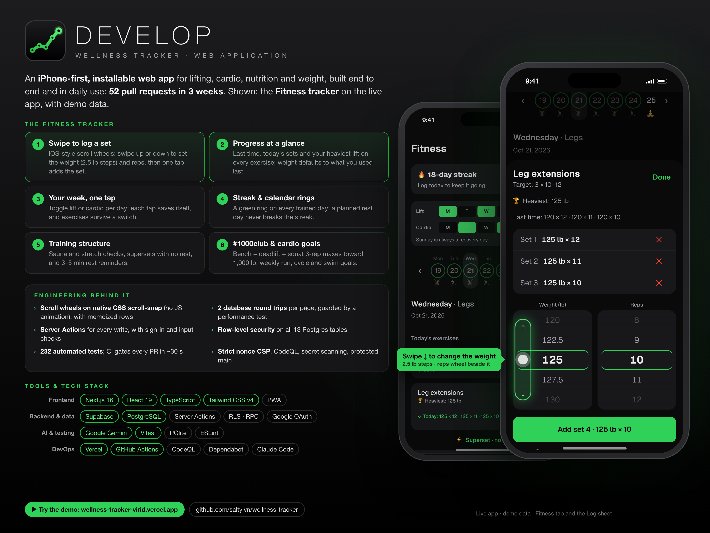
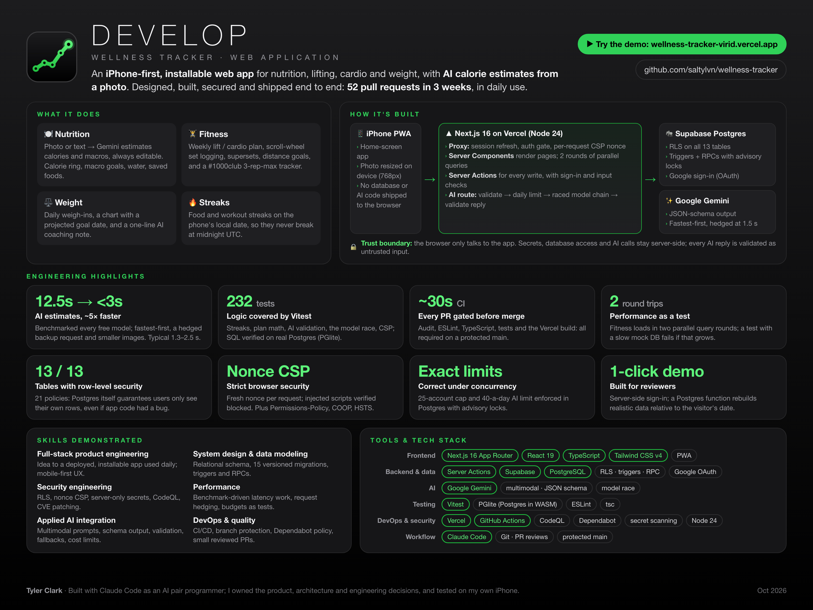

# DEVELOP

**A wellness tracker for weight, food, lifting and cardio.** An iPhone-first web app (installable PWA) I use every day: log meals by photo or description with AI-estimated calories and macros, follow a weekly lifting and cardio plan, and track weight against a target with a projected goal date.

> **Live:** [wellness-tracker-virid.vercel.app](https://wellness-tracker-virid.vercel.app): tap **Try the demo** to look around with sample data, no sign-up needed · **Status:** in daily use

## What it does

- **Nutrition:** add food by **photo** or **typed description**, and Google Gemini estimates calories, protein, carbs and fat (always editable before saving). Daily totals against a calorie goal in a ring, macro goals with progress bars, a saved-foods library, and a one-tap water tracker.
- **Fitness:** a week calendar drives the page. You choose which days are lifting and which are cardio.
  - **Lifting days:** your own exercise list with sets and rep ranges, supersets, rest reminders, iOS-style scroll wheels to log weight and reps, and last time / today / heaviest on each exercise.
  - **Cardio days:** run, cycle and swim with distance and time, plus weekly distance goals with progress bars.
- **Weight:** a daily weigh-in on scroll wheels, start / current / target with a progress bar, a chart with the target line and a projection, weeks to go and a goal date at a fixed weekly pace. Gemini adds a one-line coaching note.
- **Streaks:** consecutive-day streaks for food and for workouts (a planned rest day doesn't break it), with best-streak and milestone celebrations.

## How it was built: AI-assisted engineering

I built DEVELOP with **Claude Code** as an AI pair programmer, starting as a beginner in web development. I owned the product and the decisions:

- every feature and screen, tested on my own iPhone;
- small milestones, each one a pull request with tests, reviewed and merged by me (50+ merged PRs);
- trade-offs like staying on free tiers, keeping AI calls on the server, and storing dates as local calendar days so streaks don't break at midnight.

The working rules for the AI are versioned in the repo ([`CLAUDE.md`](CLAUDE.md)), alongside the code they shaped.

## Architecture

| Layer             | Choice                                                                         | Why                                                                                   |
| ----------------- | ------------------------------------------------------------------------------ | ------------------------------------------------------------------------------------- |
| UI and server     | Next.js 16 (App Router), React 19 Server Components and Server Actions, TypeScript | One codebase; data access and secrets stay on the server                              |
| Styling           | Tailwind CSS v4 with named color tokens                                        | Consistent theme; mobile-first with 44px+ tap targets and safe-area insets            |
| Database and auth | Supabase: Postgres, row-level security, Google sign-in                         | Real relational data; the database itself enforces who can see what                   |
| AI                | Google Gemini (server-side only), JSON schema output, raced model chain        | Photo and text nutrition estimates on the free tier                                   |
| Hosting and CI    | Vercel (Node 24), GitHub Actions, Dependabot                                   | Every pull request is checked; every merge to `main` deploys                          |

**Data model:** 13 tables (profiles, food entries, saved foods, water, weigh-ins, workout days / exercises / sessions / sets, cardio, tanning, AI request log, demo state), each created by a versioned SQL migration in [`supabase/migrations/`](supabase/migrations/).

## AI features

| Feature            | How                                                                                                                                                                   |
| ------------------ | --------------------------------------------------------------------------------------------------------------------------------------------------------------------- |
| Food from a photo  | The photo is shrunk to 768px on the phone as soon as it's picked, sent to Gemini with a JSON schema, validated and range-checked, and fills an editable form; nothing saves on its own |
| Food from text     | Same pipeline from a plain description ("2 eggs and buttered toast")                                                                                                  |
| Speed              | Fastest free models first with minimal thinking; if one hasn't answered in 1.5 s a backup starts alongside it and the first answer wins. Measured: **12.5 s → 1.3–2.5 s** |
| Reliability        | Overloaded or retired models fall through to the next, a bad key stops at once, per-model timeouts and a total time budget                                           |
| Weight coaching    | A one-line note, regenerated only when the numbers it was written for change                                                                                          |
| Cost control       | A 40-a-day limit per person, logged in Postgres before the AI is called                                                                                              |

## Security

- **Row-level security on all 13 tables** (21 policies): every row belongs to one signed-in user, enforced by Postgres.
- **Server-side secrets only:** the Gemini key never reaches the browser; AI replies are treated as untrusted input and validated before use. Google sign-in starts on the server.
- **Strict Content Security Policy** with a fresh nonce per request: only the app's own scripts run, and injected markup (script tags, event handlers) is blocked. Plus a Permissions-Policy (no camera API, microphone, location or payments), cross-origin window isolation, nosniff, no framing, a strict referrer policy, and HSTS.
- **GitHub:** a protected `main` (pull requests only, required checks, linear history, no force-push), secret scanning with push protection, CodeQL code scanning, Dependabot alerts and security updates, and GitHub Actions pinned to commit SHAs. See [`SECURITY.md`](SECURITY.md) to report a problem.

## Quality

- **232 automated tests** (Vitest) for the pure logic: streaks, goal and weight-plan math, AI reply validation, the model race (slow model gets a backup, failures hand off, time budget), the Content Security Policy, and more. Database migrations are verified against real Postgres (PGlite).
- **A performance test** times the Fitness page's data loading against a simulated 50 ms database and fails if a day takes more than 2 round trips.
- **CI on every pull request** (about 30 seconds): production dependency audit, ESLint, TypeScript type check and all tests; plus Vercel's production build. Both must pass before anything merges.

## Engineering decisions

- **Dates are local calendar days, not UTC timestamps.** A meal logged at 11 pm counts for that day, so daily totals and streaks don't break at midnight.
- **Pure logic lives in `lib/` with tests;** pages and components stay thin. Streaks, goal status, the weight plan and AI reply validation are all plain functions.
- **Race, don't wait.** Free AI models are sometimes overloaded, so a slow request gets a backup instead of a long timeout. The race is a small pure function with its own tests, separate from the Google SDK.
- **The Fitness page loads in two database round trips, enforced by a test.** Two rounds of parallel queries; a test times it against a simulated slow database and fails if a lifting or cardio day needs more.
- **Exact limits in the database.** The 40-a-day AI limit is one Postgres function call under a per-person lock: one round trip, and two requests at once can't both squeeze past it.
- **Free tiers by design.** Supabase, Gemini and Vercel free tiers, with a per-person AI limit so one user can't use up the shared quota.
- **A one-click demo, safely.** "Try the demo" signs in to a shared account on the server (the password never reaches the browser). A Postgres function rebuilds its sample data relative to the visitor's date, at most hourly, and only the demo account can run it. Email sign-up is refused for everyone else, and the AI limit survives resets.
- **Capped at 25 accounts, on purpose.** DEVELOP is a personal and portfolio app, not built to scale. A Postgres trigger refuses the 26th sign-up (with a lock, so two sign-ups at once can't both slip in), and the login page explains that it's full.

## Running locally

Requires Node.js 24 (see [`.nvmrc`](.nvmrc), the version production runs) and a free [Supabase](https://supabase.com) project.

1. `npm install`
2. Copy `.env.example` to `.env.local` and fill in `NEXT_PUBLIC_SUPABASE_URL`, `NEXT_PUBLIC_SUPABASE_PUBLISHABLE_KEY` and `GEMINI_API_KEY` (a free key from Google AI Studio).
3. Run the SQL files in `supabase/migrations/` in order in the Supabase SQL Editor, and enable Google sign-in.
4. `npm run dev` and open http://localhost:3000

`npm test` runs the unit tests; `npm run build` makes a production build.

### Recruiter demo (optional)

1. Run `supabase/migrations/20261025000000_recruiter_demo.sql` in the SQL Editor (after the earlier migrations).
2. In Supabase **Authentication → Sign In / Providers**, enable **Email** (the database refuses email sign-ups other than the demo's).
3. In **Authentication → Users → Add user**, create `demo@example.com` with a strong password and **Auto Confirm User** on.
4. Set `DEMO_EMAIL=demo@example.com` and `DEMO_PASSWORD=…` in `.env.local` and in Vercel (mark the password **Sensitive**), then redeploy. The **Try the demo** button appears once both are set.

## Roadmap

Shipped: PWA shell and deploy, Google sign-in, food log with macro goals, AI text and photo estimates, streaks, workouts, cardio, water, the Weight tab with an AI coaching note, and the DEVELOP rename with a launch splash.

Next: polish and real-iPhone testing of photo logging, scroll wheels and checkboxes.
