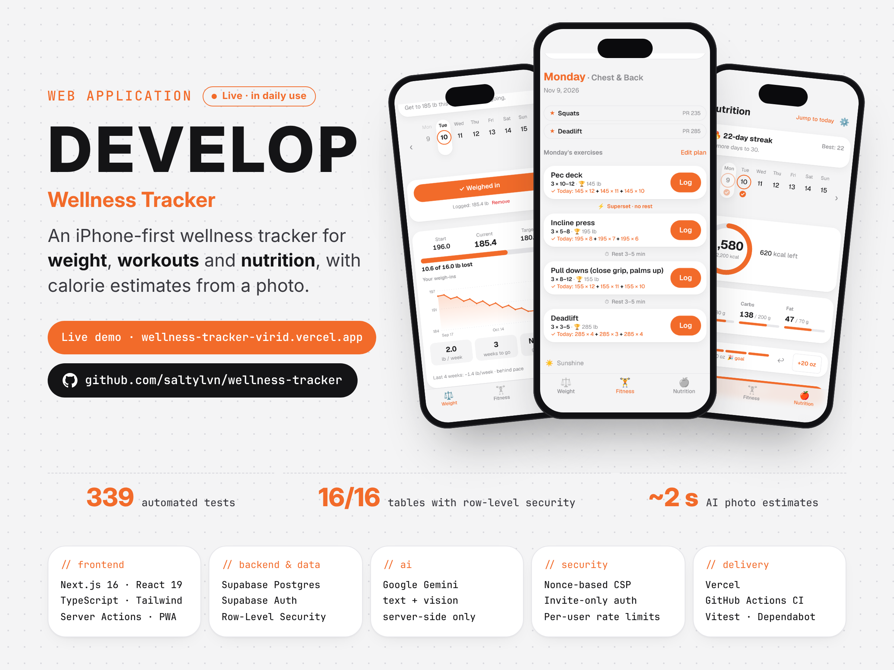
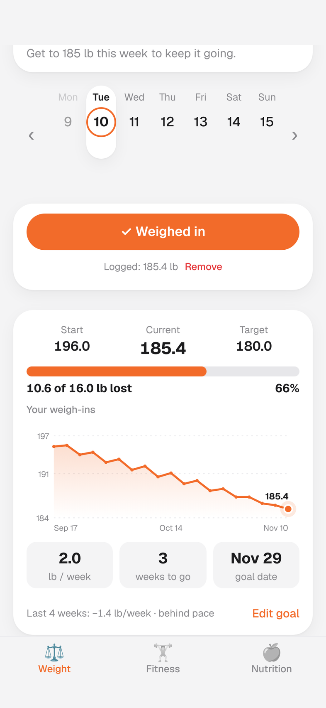
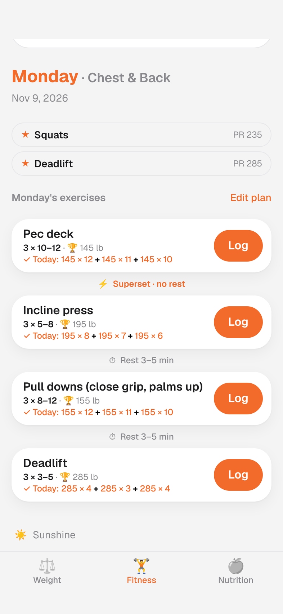
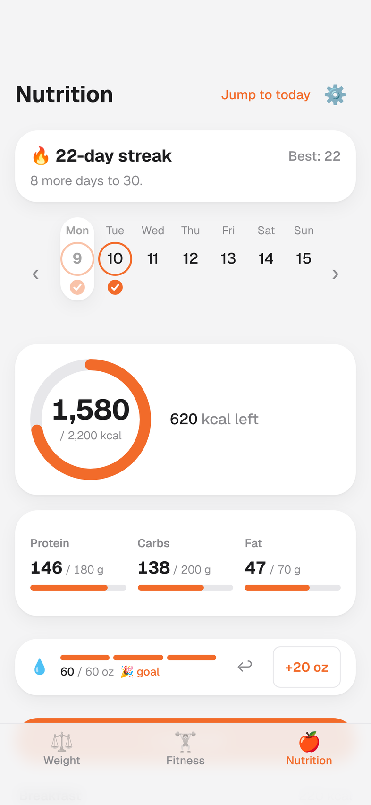
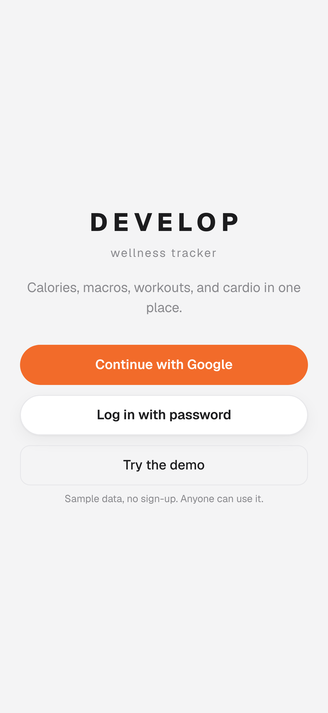
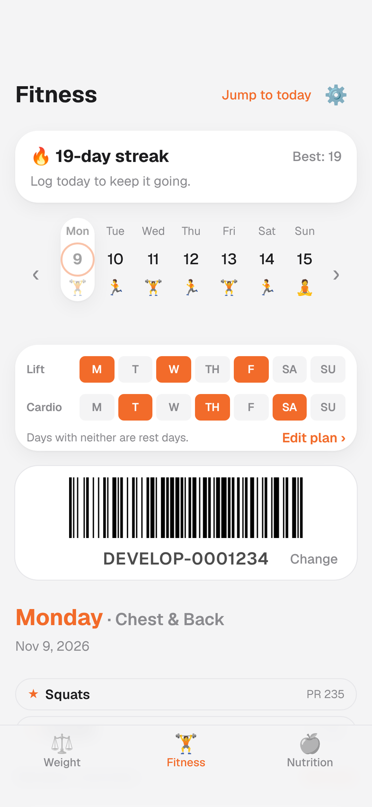
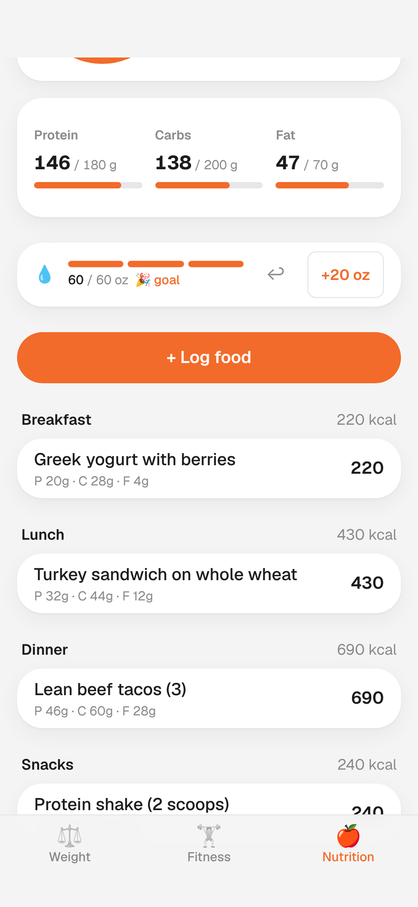
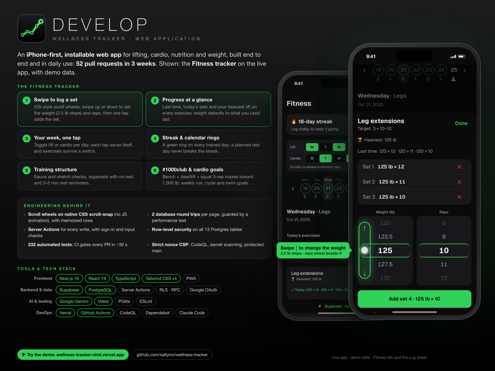
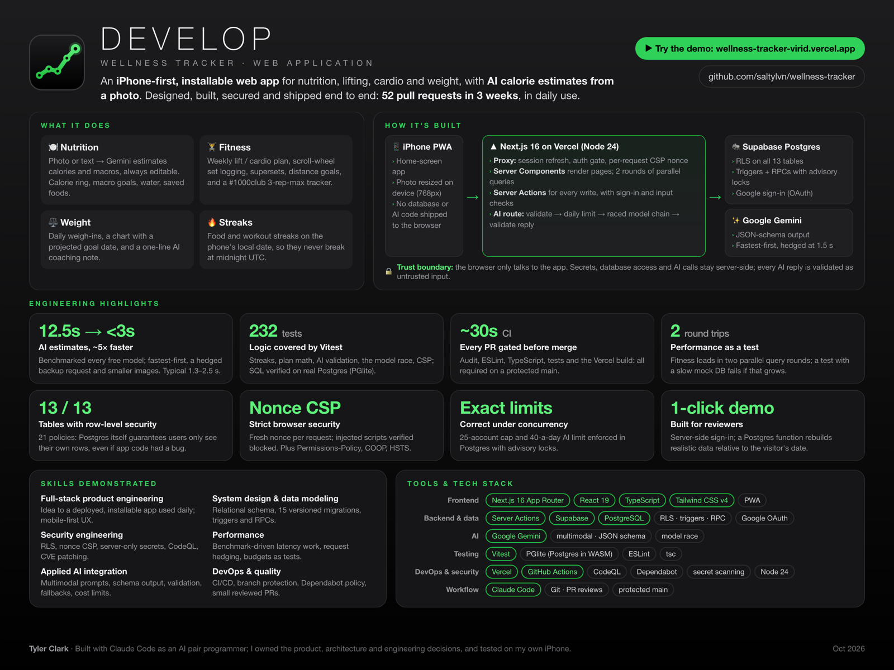
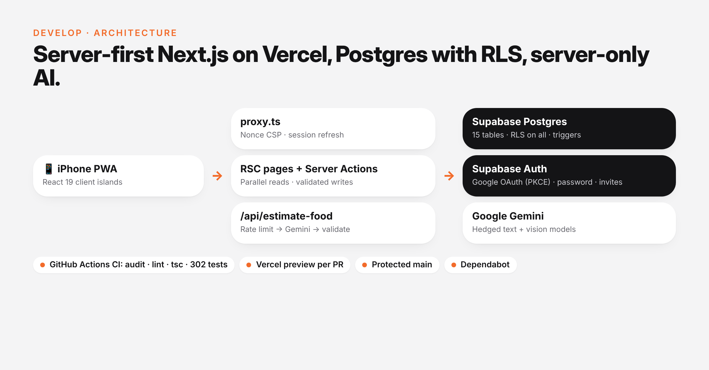

# DEVELOP

**A wellness tracker for weight, workouts and nutrition.** An iPhone-first, installable web app (PWA) I designed, built and use every day: log meals by photo or description with AI-estimated calories and macros, plan and log lifting and cardio, and track weight against a goal with a projected goal date.

> **Live demo:** [wellness-tracker-virid.vercel.app](https://wellness-tracker-virid.vercel.app). Tap **Try the demo** for a full sample account, no sign-up needed · **Status:** v2.0, in daily use

## What it does

- **Weight:** daily weigh-ins on scroll wheels, start / current / target with a progress bar, a hand-built SVG chart from your starting date to today, weekly pace, weeks to go and a projected goal date, and a weekly weight-loss streak.
- **Fitness:** a week calendar drives the page. Toggle which days are for lifting, cardio, both or rest.
  - **Lifting:** your own exercises with sets and rep ranges, supersets, rest reminders, weight / reps or timed sets on scroll wheels, and your PR on every card. Two "priority lifts" sit at the top with their PRs.
  - **Cardio and recovery:** plan a run, ride, swim or walk (or a walk, bike ride or yoga on rest days) with a target, then tick **Completed**; distances convert to count toward weekly goals.
  - A gym check-in barcode, read from a screenshot in the browser and redrawn on the server.
- **Nutrition:** add food by **photo** or **description** and Google Gemini estimates calories, protein, carbs and fat (always editable before saving); a calorie ring, macro goals, water tracking and a saved-foods library.
- **Streaks** for workouts and food, plus a daily sunshine log.
- **Accounts:** Google sign-in or username and password, invite-only sign-up, and an admin view to text invites and see users.

## Screens (v2.0)

Real screenshots from the live demo on an iPhone 15 Pro.

| Weight | Fitness | Nutrition |
| :---: | :---: | :---: |
|  |  |  |
|  |  |  |

## Progress: v1.0 → v2.0

DEVELOP v1.0 shipped in October 2026; v2.0 is what's live now.

| | v1.0 | v2.0 |
| --- | --- | --- |
| Design | Dark theme with green accents | Light orange-and-white redesign, consistent layout across all three tabs, new app icon |
| Weight | Weigh-ins, chart and an AI coaching note | A chart from your chosen starting date to today, a weekly loss streak, and bold progress; the AI note was removed as low value |
| Fitness | Weekly plan, set logging, cardio | Plus priority lifts with PRs, planned cardio and recovery days you tick off, timed sets, weekly walking goals and a gym barcode |
| Accounts | Google sign-in and a demo | Plus username and password, invite-only sign-up enforced in the database, and an admin view to text invites and see users |
| Engineering | 232 tests, 13 tables, 21 RLS policies | 311 tests, 15 tables, 25 RLS policies, decision records, MIT license |

v1.0 screenshots

## How it's built

| Layer             | Choice                                                                             | Why                                                                         |
| ----------------- | ---------------------------------------------------------------------------------- | --------------------------------------------------------------------------- |
| UI and server     | Next.js 16 (App Router), React 19 Server Components and Server Actions, TypeScript | One codebase; data access and secrets stay on the server                    |
| Styling           | Tailwind CSS v4 with named color tokens                                            | Consistent theme; mobile-first with 44px+ tap targets and safe-area insets  |
| Database and auth | Supabase: Postgres with row-level security, Google OAuth and password sign-in       | Real relational data; the database itself enforces who can see what        |
| AI                | Google Gemini (server-side only), JSON-schema output, raced model chain            | Photo and text nutrition estimates on the free tier                         |
| Hosting and CI    | Vercel (Node 24), GitHub Actions, Dependabot                                       | Every pull request is checked and previewed; every merge to `main` deploys  |

**Data model:** 15 tables (profiles, food entries, saved foods, water, weigh-ins, workout days / exercises / sessions / sets, cardio, sunshine, AI request log, demo state, invite codes, admins), created by 26 versioned SQL migrations in [`supabase/migrations/`](supabase/migrations/), written so the app keeps working before and after each one runs.

## AI features

| Feature           | How                                                                                                                                                                                     |
| ----------------- | --------------------------------------------------------------------------------------------------------------------------------------------------------------------------------------- |
| Food from a photo | The photo is shrunk to 768px on the phone as soon as it's picked (never stored), sent to Gemini with a JSON schema, validated and range-checked, and fills an editable form            |
| Food from text    | The same pipeline from a plain description ("2 eggs and buttered toast")                                                                                                                |
| Speed             | Fastest free models first; if one hasn't answered in 1.5 s a backup starts alongside it and the first valid answer wins (`raceModels`). Measured: **12.5 s → 1.3–2.5 s**               |
| Reliability       | Overloaded or retired models fall through to the next, a bad key stops at once, per-model timeouts and a total time budget; every in-flight request is cancelled once there's an answer |
| Cost control      | A 40-a-day limit per person, taken atomically in Postgres before the AI is called                                                                                                       |

## Security

- **Row-level security on all 15 tables** (25 policies): every row belongs to one signed-in user, enforced by Postgres.
- **Invite-only accounts:** a `BEFORE INSERT` trigger on `auth.users` refuses any new account without an unused, unexpired invite code, including Google sign-ups. Only the admin can create or revoke codes; the admin role lives in a table with no write policies.
- **Server-side secrets only:** the Gemini key never reaches the browser; AI replies are treated as untrusted input and validated before use. Google sign-in starts on the server (PKCE).
- **Strict Content Security Policy** with a fresh nonce per request (`strict-dynamic`, `frame-ancestors 'none'`, `object-src 'none'`), plus a Permissions-Policy, cross-origin window isolation, nosniff, no framing and a strict referrer policy. HTTPS everywhere (HSTS on Vercel).
- **Limits under concurrency:** the 25-account cap and the AI daily limit use Postgres advisory locks, so two requests at once can't both slip past.
- **GitHub:** a protected `main` (pull requests only, required checks, no force-push), secret scanning with push protection, CodeQL, Dependabot, and Actions pinned to commit SHAs with a read-only token. See [`SECURITY.md`](SECURITY.md) to report a problem.

## Quality

- **311 automated tests** (Vitest) for the pure logic: streaks, goal and weight-plan math, chart ranges, AI reply validation, the model race (slow model gets a backup, failures hand off, time budget), the Content Security Policy, account and invite rules, cardio unit conversion, the database helpers (against a shared fake Supabase client), and more.
- **A performance test** times the Fitness page's data loading against a simulated 50 ms database and fails if a day takes more than 2 round trips.
- **CI on every pull request** (about 30 seconds): production dependency audit, ESLint, TypeScript type check and all tests, plus Vercel's preview build. Both must pass before anything merges.

## Engineering decisions

- **Dates are local calendar days, not UTC timestamps.** A meal logged at 11 pm counts for that day, so daily totals and streaks don't break at midnight.
- **Pure logic lives in `lib/` with tests;** pages and components stay thin.
- **Rules live in the database.** Permissions (RLS), invite-only sign-up (a trigger), the account cap and the AI limit (functions under a lock) can't be bypassed by a bug in a route.
- **Race, don't wait.** Free AI models are sometimes overloaded, so a slow request gets a backup instead of a long timeout. The race is a small generic function with its own tests, separate from the Google SDK, and the provider sits behind one file (`lib/ai/gemini.ts`).
- **The Fitness page loads in two database round trips, enforced by a test.**
- **Migrations that don't break the live app.** New columns are read defensively, so each deploy works before its SQL step has run.
- **Free tiers by design.** Supabase, Gemini and Vercel free tiers, with per-person limits so one user can't use up the shared quota.
- **A one-click demo, safely.** "Try the demo" signs in to a shared account on the server (the password never reaches the browser), and a Postgres function rebuilds its sample data around the visitor's date, at most hourly.

Longer write-ups of these choices are in [`docs/decisions/`](docs/decisions/).

## How I built it

I built DEVELOP with a coding agent (Claude Code), run as an engineering process: a versioned [`CLAUDE.md`](CLAUDE.md) is the project's living spec (architecture, conventions, constraints) and is updated in the same pull request as the code it describes; work ships as small pull requests with clear acceptance criteria; bugs are reproduced before they're fixed, UI changes are checked at phone size and database changes against a local Postgres; and CI plus preview deploys gate every merge. I made the product, architecture and security decisions, and reviewed and tested every change on my own phone.

## Running locally

Requires Node.js 24 (see [`.nvmrc`](.nvmrc)) and a free [Supabase](https://supabase.com) project.

1. `npm install`
2. Copy `.env.example` to `.env.local` and fill in `NEXT_PUBLIC_SUPABASE_URL`, `NEXT_PUBLIC_SUPABASE_PUBLISHABLE_KEY` and `GEMINI_API_KEY` (a free key from Google AI Studio).
3. Run the SQL files in `supabase/migrations/` in order in the Supabase SQL Editor. Enable Google sign-in, and the Email provider with **Confirm email** off (usernames are stored as app-only addresses and never emailed).
4. Make yourself the admin: `insert into public.app_admins (user_id) select id from auth.users where email = 'YOUR_EMAIL';` (after signing in once; see the end of `20261105000000_username_invites.sql`). Sign-up is invite-only, so create the very first account with the trigger briefly off: `alter table auth.users disable trigger require_invite_code;` then sign in, then `enable` it again.
5. `npm run dev` and open http://localhost:3000

`npm test` runs the unit tests; `npm run build` makes a production build.

### Recruiter demo (optional)

1. Run `supabase/migrations/20261025000000_recruiter_demo.sql` (after the earlier migrations).
2. Create `demo@example.com` in **Authentication → Users → Add user** with a strong password and **Auto Confirm User** on. Because sign-up is invite-only, turn the `require_invite_code` trigger off for that step (step 4 above) or create an invite code for it.
3. Set `DEMO_EMAIL=demo@example.com` and `DEMO_PASSWORD=…` in `.env.local` and in Vercel (mark the password **Sensitive**), then redeploy. The **Try the demo** button appears once both are set.

## Roadmap

Shipped: PWA shell and deploy, sign-in (Google, username and password, invite-only), food log with macro goals, AI text and photo estimates, streaks, workouts with PRs and priority lifts, planned cardio and recovery days, water and sunshine logs, the Weight tab with a chart and goal date, and an admin view.

Next: real-iPhone testing of photo logging and the scroll wheels, and integration tests for the server actions.

## License

[MIT](LICENSE)
